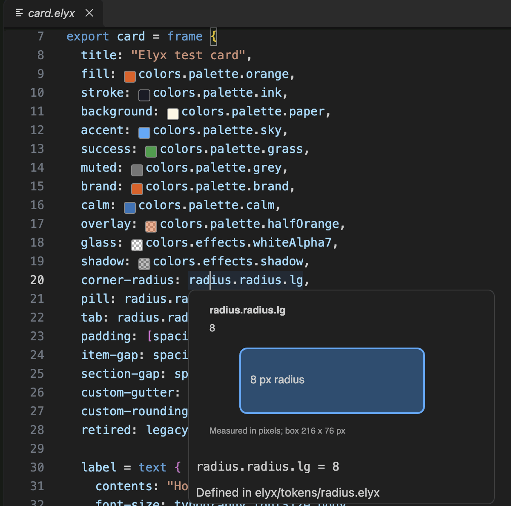
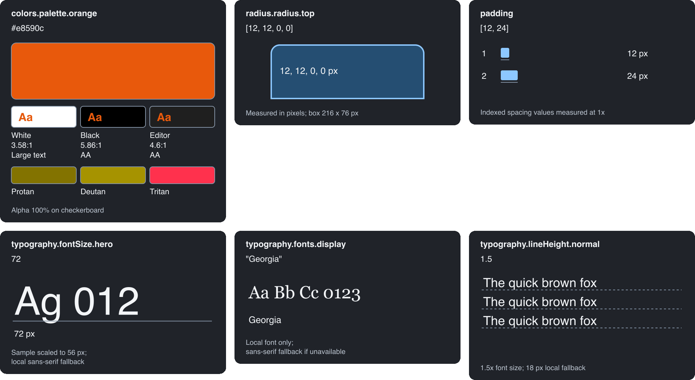
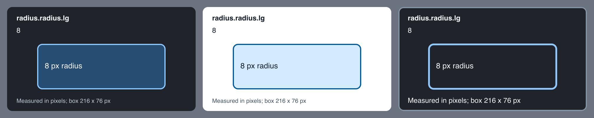

# Elyx Syntax and Previews

Highlights `.elyx` design files in VS Code and VSCodium, with colour swatches
and visual hover cards for design tokens.

Comments, strings and escapes, numbers, length units, hex colours, atoms,
keywords, annotations, declarations, property keys, source types, override
labels, function calls, paths and punctuation have specific TextMate scopes.
Your editor theme chooses their colours.



## Install

### VS Code

Search for "Elyx" in the Extensions view, or install it from the
[Visual Studio Marketplace](https://marketplace.visualstudio.com/items?itemName=nord-forge.elyx).
From a terminal:

```sh
code --install-extension nord-forge.elyx
```

### VSCodium and other Open VSX editors

VSCodium, Cursor, Windsurf and Gitpod install extensions from
[Open VSX](https://open-vsx.org/extension/nord-forge/elyx). Search for "Elyx"
in the Extensions view, or run:

```sh
codium --install-extension nord-forge.elyx
```

On macOS, VSCodium may need Shell Command: Install 'codium' command in PATH
before its terminal command works.

### From a VSIX file

Every release on the [releases page](https://github.com/nord-forge/vscode-elyx/releases)
has an `elyx-<version>.vsix` file attached. Download it, then run:

```sh
code --install-extension elyx-0.4.0.vsix
codium --install-extension elyx-0.4.0.vsix
```

You can also use Extensions > ... > Install from VSIX in either editor.

### From source

Install Bun and Node.js 22 or newer. Then run:

```sh
git clone https://github.com/nord-forge/vscode-elyx.git
cd vscode-elyx
bun install
bun run test
bun run package
```

The output is `elyx-<version>.vsix` in the project root. Install it as above.

## Token previews

Colour token references show a small read-only swatch. Transparent colours use
a checkerboard. Hover a reference to see a small visual card, its resolved value and source file.
Literal values inside token files work too, so hovering `lg: 8` shows its radius.

| Token | Hover sample |
| --- | --- |
| Colours | Large swatch with transparency checkerboard |
| Radius | Rounded box, including four-corner values and pills |
| Spacing | Measured gap or a set of spacing bars |
| Font size and family | Text sample using local fonts with fallback |
| Line height and letter spacing | Text with measured illustrative spacing |
| Font weight | Weighted text sample |
| Other resolved values | Labelled value card |



Very large samples scale to fit and say so. Unsupported units and negative
radii show their values without inventing a shape. These are illustrative
samples rather than a full rendered Elyx layer.

For example, `colors.effects.whiteAlpha7` resolves to `#ffffff12` in the sample
project in `test/manual`. Previewing a token never replaces it with a literal colour.

## Settings

Every setting can be set per user, per workspace or per workspace folder.
`elyx.refreshDelay` applies per window.

### Token discovery

| Setting | Default | Options | Effect |
| --- | --- | --- | --- |
| `elyx.tokenDirectories` | `["design/tokens", "elyx/tokens"]` | Workspace-relative folders | Folders searched for token files, including subfolders. |
| `elyx.tokenExclude` | `["**/node_modules/**", "**/.git/**", "**/vendor/**"]` | Globs, one per entry, without braces or commas | Files skipped during that search. Imported files still load. |
| `elyx.refreshDelay` | `100` | `0` to `2000` ms | Wait after an edit before swatches refresh. |

### Colour swatches

| Setting | Default | Options | Effect |
| --- | --- | --- | --- |
| `elyx.colorPreviews.enabled` | `true` | `true`, `false` | Shows swatches beside colour tokens. Hovers still work when off. |
| `elyx.colorPreviews.position` | `"before"` | `"before"`, `"after"` | Puts the swatch before or after the token. |
| `elyx.colorPreviews.size` | `0.9` | `0.5` to `2` em | Swatch size, relative to the editor font size. |
| `elyx.colorPreviews.borderColor` | `"#888888"` | Hex colour | Swatch border. |
| `elyx.colorPreviews.checkerboard` | `{}` | `light` and `dark` hex colours | Squares behind transparent swatches. The defaults are `#ffffff` and `#aaaaaa`. |

### Hover content

| Setting | Default | Options | Effect |
| --- | --- | --- | --- |
| `elyx.tokenPreviews.visualHovers` | `true` | `true`, `false` | Shows the visual card. When off, hovers are text only. |
| `elyx.tokenPreviews.showColorHex` | `true` | `true`, `false` | Shows the `Colour:` line with the resolved hex value. |
| `elyx.tokenPreviews.showColorName` | `true` | `true`, `false` | Adds a plain name after the hex value, such as `vivid orange`. |
| `elyx.tokenPreviews.showContrast` | `true` | `true`, `false` | Shows text contrast for colour tokens, in the card and the hover text. |
| `elyx.tokenPreviews.colorVision` | `true` | `true`, `false` | Shows colour tokens as seen with protanopia, deuteranopia and tritanopia. |
| `elyx.tokenPreviews.showDefinition` | `true` | `true`, `false` | Shows the `Defined in` line with the token's file. |

### Card appearance

| Setting | Default | Options | Effect |
| --- | --- | --- | --- |
| `elyx.tokenPreviews.theme` | `"editor"` | `"editor"`, `"auto"`, `"dark"`, `"light"` | Where card colours come from. See below. |
| `elyx.tokenPreviews.darkColors` | `{}` | Colour object | Hex overrides when the card is dark. |
| `elyx.tokenPreviews.lightColors` | `{}` | Colour object | Hex overrides when the card is light. |
| `elyx.tokenPreviews.themeColors` | `{}` | Theme name keys with colour objects | Hex overrides for named editor themes. These apply last. |
| `elyx.tokenPreviews.fontFamily` | `"sans-serif"` | Font names with letters, digits, spaces, commas and hyphens | Font for card labels and the fallback for typography samples. |



With `"editor"`, the default, cards use your editor theme. The extension reads
the active theme file and `workbench.colorCustomizations`, then takes the hover
widget, text, link and selection colours. Any colour the theme leaves out falls
back to the built-in palette. `"auto"` uses the built-in dark or light palette
to match the theme. `"dark"` and `"light"` always use one of them.

Overrides apply in this order, and later ones win:

1. Built-in palette
2. Editor theme colours, with `"editor"` only
3. `darkColors` or `lightColors`
4. `themeColors` entries that match the active theme

Colour objects accept `background`, `surface`, `text`, `mutedText`, `line`,
`accent`, `accentSoft`, `checkerLight` and `checkerDark`. Leave a key out to
keep the colour below it. Values must be hex colours. Anything else is ignored.

`themeColors` keys use the same form as `workbench.colorCustomizations`. That
means `[Theme Name]`, `[One][Two]` for several themes, or `*` as a wildcard.

```json
{
  "elyx.tokenPreviews.darkColors": {"accent": "#ffb86c"},
  "elyx.tokenPreviews.themeColors": {
    "[Solarized Light]": {"background": "#fdf6e3", "accent": "#268bd2"},
    "[*High Contrast*]": {"line": "#ffffff"}
  }
}
```

### Samples

| Setting | Default | Options | Effect |
| --- | --- | --- | --- |
| `elyx.tokenPreviews.sampleText` | `""` | Up to 80 characters | Replaces the text in typography samples. Empty keeps the built-in samples. |
| `elyx.tokenPreviews.fontWeights` | `{}` | Names with numbers from 1 to 1000 | Extra weight names, such as `{"book": 450}`. Built-in names such as `bold` and `semi-bold` still work. |
| `elyx.tokenPreviews.maxFontSize` | `56` | `8` to `96` | Largest font size drawn at full size. Larger sizes are scaled down and say so. |
| `elyx.tokenPreviews.maxSpacing` | `160` | `20` to `170` px | Largest spacing drawn at 1x. Larger gaps are scaled to fit and say so. |
| `elyx.tokenPreviews.propertyNames` | `{}` | Sample types with lists of names | Extra names that choose a sample type. |

`propertyNames` keys are `font-size`, `line-height`, `letter-spacing`,
`font-weight`, `font-family`, `radius` and `spacing`. Names match property
keys, group names and file names. A camelCase name such as `bodySize` also
matches `body-size`.

```json
{
  "elyx.tokenPreviews.propertyNames": {"spacing": ["gutter", "inset"], "radius": ["rounding"]}
}
```

### Accessibility

| Setting | Default | Options | Effect |
| --- | --- | --- | --- |
| `elyx.tokenPreviews.minimumContrast` | `"AA"` | `"AA"`, `"AAA"`, `"off"` | Repairs card colours that fall below this contrast level. `"off"` uses them as given. |
| `elyx.tokenPreviews.highContrast` | `"auto"` | `"auto"`, `"on"`, `"off"` | High contrast cards. `"auto"` follows high contrast editor themes. |
| `elyx.tokenPreviews.scale` | `1` | `1` to `2` | Draws the whole card larger. |
| `elyx.tokenPreviews.textDescriptions` | `"auto"` | `"auto"`, `"always"`, `"never"` | Adds a written description of the card to the hover text. `"auto"` does this when `editor.accessibilitySupport` is `"on"`. |

Hover cards check their own colours. With the default `"AA"`, card text gets at
least 4.5:1 contrast against the card, its panels and its fills. Lines and
shapes get at least 3:1. `"AAA"` raises text to 7:1. A colour that falls short
is moved towards white or black until it passes. This only changes the card.
Token colours are always shown exactly.

High contrast cards add a card border, use 2 px lines, drop the soft fills,
enlarge the footnote and ask for AAA contrast.

The card is 320 pixels wide, and the size of each sample inside it is fixed.
`scale` enlarges the whole card.

Each card image has alt text that describes the sample, such as "Rounded box
with 8 px corners". VS Code shows hover text in the Accessible View (Alt+F2 on
Windows and Linux, Option+F2 on macOS).

Colour tokens get three checks:

- A plain name after the hex value, such as `#e8590c (vivid orange)`.
- Contrast when the colour is used as text on white, black and the editor
  background, rated against WCAG 2.2. Translucent colours are measured after
  blending with each background. The card shows each pairing as an `Aa` sample.
- Simulations for protanopia, deuteranopia and tritanopia, using the Machado,
  Oliveira and Fernandes (2009) model at full severity.

Colour names and simulations are approximations. Use them as a first check
rather than a full audit.

### Editor settings that affect Elyx

| Setting | Effect on Elyx |
| --- | --- |
| `editor.tokenColorCustomizations` | Changes syntax colours. Target a scope from the scope reference below. |
| `workbench.colorCustomizations` | Hover widget colours here also reach the cards when `theme` is `"editor"`. |
| `editor.accessibilitySupport` | When `"on"`, adds written card descriptions to hovers if `textDescriptions` is `"auto"`. |
| `files.associations` | Picks Elyx when another extension also claims `.elyx`. See Language association. |

Your colour theme picks the syntax colours. To change one, target its scope:

```json
{
  "editor.tokenColorCustomizations": {
    "textMateRules": [
      {"scope": "storage.type.kind.elyx", "settings": {"foreground": "#c792ea"}},
      {"scope": "constant.other.color.rgb-value.hex.elyx", "settings": {"fontStyle": "bold"}}
    ]
  }
}
```

Zed has no extension settings. Its `languages` and `theme_overrides` settings
adjust Elyx files there. See `zed/README.md`.

<details>
<summary>All Elyx settings with their defaults</summary>

```json
{
  "elyx.tokenDirectories": ["design/tokens", "elyx/tokens"],
  "elyx.tokenExclude": ["**/node_modules/**", "**/.git/**", "**/vendor/**"],
  "elyx.refreshDelay": 100,

  "elyx.colorPreviews.enabled": true,
  "elyx.colorPreviews.position": "before",
  "elyx.colorPreviews.size": 0.9,
  "elyx.colorPreviews.borderColor": "#888888",
  "elyx.colorPreviews.checkerboard": {},

  "elyx.tokenPreviews.visualHovers": true,
  "elyx.tokenPreviews.showColorHex": true,
  "elyx.tokenPreviews.showColorName": true,
  "elyx.tokenPreviews.showContrast": true,
  "elyx.tokenPreviews.colorVision": true,
  "elyx.tokenPreviews.showDefinition": true,

  "elyx.tokenPreviews.theme": "editor",
  "elyx.tokenPreviews.darkColors": {},
  "elyx.tokenPreviews.lightColors": {},
  "elyx.tokenPreviews.themeColors": {},
  "elyx.tokenPreviews.fontFamily": "sans-serif",

  "elyx.tokenPreviews.sampleText": "",
  "elyx.tokenPreviews.fontWeights": {},
  "elyx.tokenPreviews.maxFontSize": 56,
  "elyx.tokenPreviews.maxSpacing": 160,
  "elyx.tokenPreviews.propertyNames": {},

  "elyx.tokenPreviews.minimumContrast": "AA",
  "elyx.tokenPreviews.highContrast": "auto",
  "elyx.tokenPreviews.scale": 1,
  "elyx.tokenPreviews.textDescriptions": "auto"
}
```

</details>

## Token resolution

Explicit `.elyx` imports are followed too, including aliases whose names differ
from their file names. Bare import paths start at the workspace root. Paths
starting with `./` or `../` start at the importing file. An explicit import wins
over folder fallback. An ambiguous file name stays unresolved until imported
explicitly.

Swatches and hovers refresh after token edits, including unsaved edits. They also
refresh when token files are created or deleted and when these settings change.
Set `elyx.colorPreviews.enabled` to false to hide swatches. Value hovers remain
available. Set `elyx.tokenPreviews.visualHovers` to false to keep text-only
hovers. Open the containing project folder so imports and defaults have a
workspace root.

The resolver supports token aliases, nested maps and lists, static token
inheritance, hex colours, common colour atoms, `opacity()`, `rgb()`, `rgba()` and
`hsl()`. It does not execute theme/variant contexts, arithmetic, quoted
expressions, dependency imports or arbitrary functions. It shows statically
declared values and leaves unsupported values unresolved. The Zed companion
currently provides syntax highlighting only.

## Tests

```sh
bun run test:semantic
bun run test:review
bun run test:snapshots
bun run test:coverage
bun run test:diagnostics
bun run test:tokens
bun run test:colors
bun run test:previews
bun run test:host
```

Tests use nine sample Elyx fixtures and small cases for the language rules.
Coverage uses `vscode-textmate` with `vscode-oniguruma`.
Diagnostics need the Elyx CLI. Copied fixtures can produce missing import
and unresolved reference warnings. They must produce zero errors.

The extension provides syntax highlighting, editor configuration, colour
previews and token value hovers. It does not run the Elyx CLI while you edit.
`test:host` uses the installed VS Code app in an isolated temporary profile and
workspace. Set `ELYX_CODE_CLI` to test another compatible editor. Pure token
resolver tests run as part of `bun run test`.

## Zed

A Tree-sitter companion is in `zed/`. Run its checks with:

```sh
cd zed
bun install
bun run test
bun run prepare:local
```

Local preparation needs a Git commit containing the grammar. It generates an
`extension.toml` with a local file URL and the current commit. In Zed, use
Install Dev Extension and select the `zed/` directory. It has been tested in
Zed 1.25.3. See `zed/README.md` for details and configuration.

## Language association

If the status bar says Elysium instead of Elyx, another extension also claims
`.elyx`. Choose Elyx through Configure File Association, or add this setting:

```json
{"files.associations": {"*.elyx": "elyx"}}
```

## Scope reference

| Token | Scope |
| --- | --- |
| Comment | `comment.line.double-slash.elyx` |
| String | `string.quoted.double.elyx` |
| Escape | `constant.character.escape.elyx` |
| Number | `constant.numeric.elyx` |
| Length unit | `keyword.other.unit.elyx` |
| Hex colour | `constant.other.color.rgb-value.hex.elyx` |
| Atom | `constant.language.atom.elyx` |
| Kind | `storage.type.kind.elyx` |
| Import keyword | `keyword.control.import.elyx` |
| Modifier | `storage.modifier.elyx` |
| Reserved word | `keyword.control.reserved.elyx` |
| Annotation | `entity.name.function.decorator.elyx` |
| Declaration name | `variable.other.definition.elyx` |
| Property key | `support.type.property-name.elyx` |
| Override name | `entity.name.tag.elyx` |
| Source type | `entity.name.type.source.elyx` |
| Metadata target | `variable.language.file.elyx` |
| Function call | `support.function.elyx` |
| Named argument | `variable.parameter.function.elyx` |
| Reference | `variable.other.elyx` |
| Arithmetic and quote | `keyword.operator.arithmetic.elyx`, `keyword.operator.quote.elyx` |

Punctuation has separate scopes for braces, brackets, parentheses, separators,
root paths, annotations, strings and comments. The full list is in
[`docs/SCOPES.md`](https://github.com/nord-forge/vscode-elyx/blob/main/docs/SCOPES.md).

## Limits

TextMate reads one line at a time. If a name appears on a line before its
`=`, `:` or `{`, it keeps an ordinary variable scope. Its precise role cannot
be inferred until a later line. Kind and source scopes still resume correctly.

## Development

Update snapshots only after checking semantic assertions and token dumps:

```sh
bun run test:snapshots:update
```

The editor's extension details page only loads https images. `bun run package`
points the screenshots in `images/` at the `main` branch on GitHub, so push
screenshot changes before publishing.

### Releasing

Pushing a tag such as `v0.4.0` runs `.github/workflows/release.yml`. It tests
and packages the extension, attaches the VSIX to a GitHub release, and
publishes it to the Visual Studio Marketplace and Open VSX. The tag must match
`version` in `package.json`.

The workflow needs two repository secrets:

| Secret | Where it comes from |
| --- | --- |
| `VSCE_PAT` | An Azure DevOps personal access token with the Marketplace (Manage) scope, for the `nord-forge` publisher. |
| `OVSX_PAT` | An Open VSX access token for an account that owns the `nord-forge` namespace. |

A missing secret skips that marketplace.

## Credits

Made by [Nick Bevers](https://github.com/NickBevers) at
[Spatie](https://spatie.be). This is a community extension. It is not made by
the Elyx team.
